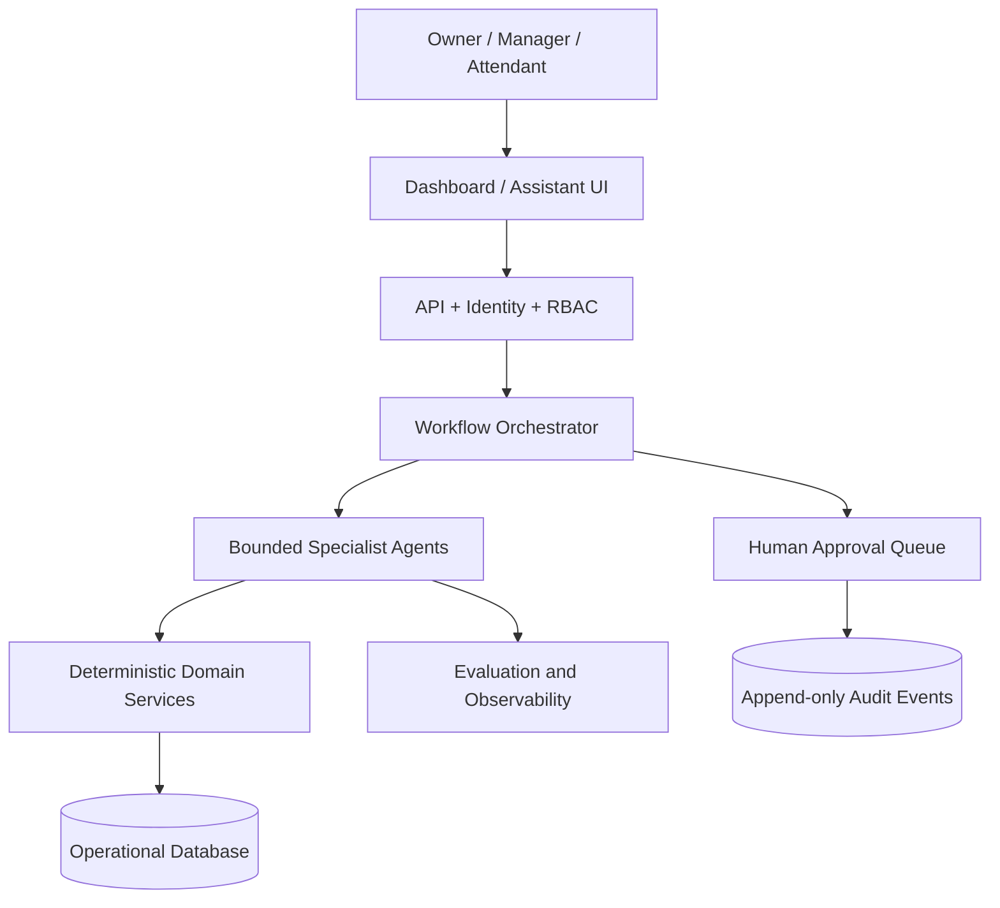

# AFSOIS — Agentic Fuel Station Operations & Intelligence System

**Portfolio system-design project | Hybrid architecture | Synthetic data only**

AFSOIS is a proposed operations-intelligence platform for retail fuel-station workflows. It models two connected flows: physical fuel movement (stock, receipts, meter-based sales and measured closing stock) and financial movement (sales value, cash/digital allocations, credit, deposits and supplier obligations).

## Governing principle
**Deterministic services own operational truth. Agents coordinate tools and explain evidence. Humans retain authority over consequential decisions.**

## Included
- System context, architecture, design decisions and agent topology
- Refined agent catalogue with responsibilities, tools, authority boundaries and escalation rules
- Shift-close, wetstock, delivery, procurement and approval workflows
- Conceptual data model and API contract outline
- Security, privacy, safety and evaluation documentation
- Synthetic fixtures and versioned demo policy
- Small Python reference functions and unit tests
- GitHub Actions workflow, publication checklist, LinkedIn and resume copy

## Implementation status
| Component | Status |
|---|---|
| Architecture, agent specs, workflows, data model, governance | Designed |
| Synthetic events and policy fixtures | Included |
| Meter delta, sales value, dip interpolation, wetstock arithmetic | Small Python reference services implemented and tested |
| API, authentication, RBAC, PostgreSQL persistence | Design only |
| Agent orchestration / LLM runtime | Design only |
| Dashboard and ML forecasting | Planned |
| Live hardware, POS, bank or supplier integration | Out of scope |

Do not describe design-only components as implemented.

## Quick start
```bash
python -m venv .venv
source .venv/bin/activate
pip install -e ".[dev]"
pytest -q
```

## Architecture at a glance


## Documentation
- `docs/architecture/` — system and agent architecture
- `docs/agents/` — agent catalogue and specification template
- `docs/workflows/` — operational workflows
- `docs/product/` — requirements, roadmap, data model, API and decision register
- `docs/governance/` — security, privacy, safety and evaluation
- `docs/portfolio/` — career copy and publication checklist

## Safety and scope
No AI control of dispensers, PLCs, tank probes, CCTV, fire systems or emergency shutdown equipment. No autonomous bank transfers, vendor payments, refunds, credit issuance or ledger corrections. Agent permissions are enforced server-side, not by prompts. All public examples are fabricated.

## Source note
The design was informed by user-provided station-operations and multi-agent design notes covering meter readings, dip-chart use, delivery verification, wetstock, shift handovers, cash/credit reconciliation and procurement. Conflicting or incomplete source rules are recorded as open decisions rather than silently assumed. The public repository contains no original operational records.
