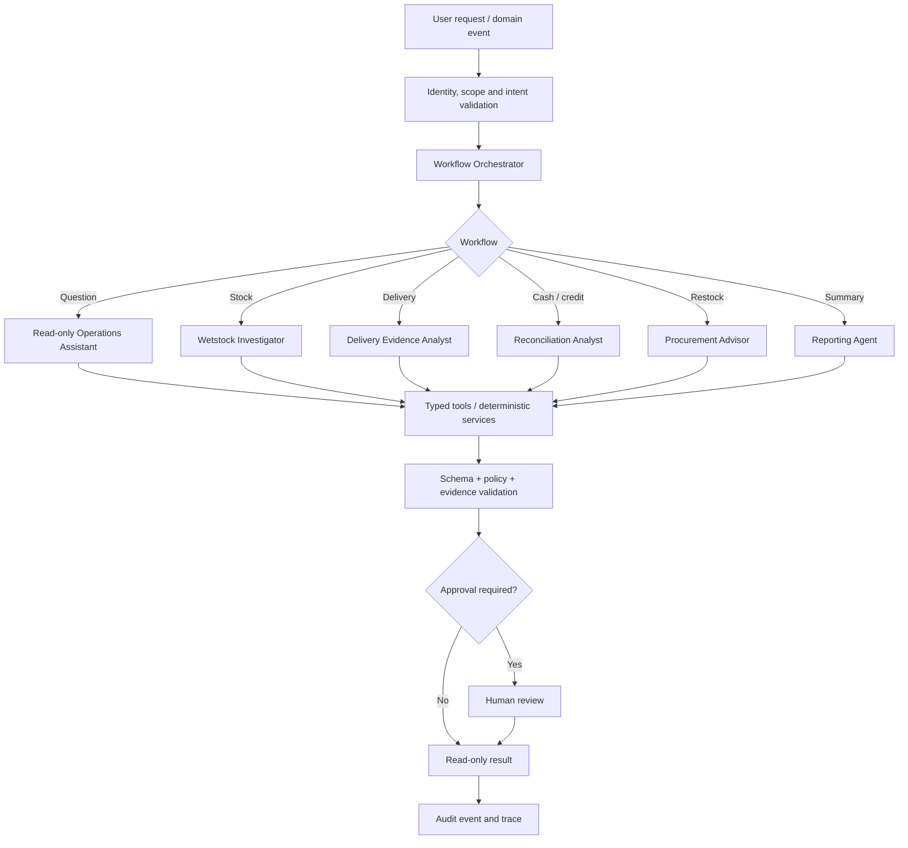

# Agent Architecture and Orchestration

## Topology


## Orchestrator duties
Authenticate scope; select allowlisted workflow; load minimum authorised context; call typed tools; enforce timeout/retry/token/delegation limits; validate schema and evidence; route consequential proposals to approval; record trace, policy version and disposition. It cannot bypass domain services or permissions.

## Agent contract
```json
{
  "schema_version":"1.0",
  "run_id":"run_demo_001",
  "task_id":"task_demo_004",
  "station_scope":"station_demo_01",
  "task_type":"wetstock.investigate",
  "input_refs":["event_demo_1","reading_demo_2"],
  "authority":"read_and_recommend",
  "deadline_seconds":30
}
```
Pass record references, not unrestricted datasets.

## State model
`RECEIVED → AUTHENTICATED → CLASSIFIED → DATA_VALIDATED → TOOL_EXECUTION → OUTPUT_VALIDATION → HUMAN_REVIEW (if required) → COMPLETED`
Other terminal states: `REJECTED`, `NEEDS_MORE_INFORMATION`, `FAILED`, `CANCELLED`, `EXPIRED`.

## Tool policy
Allow narrow typed tools such as `get_shift_summary`, `calculate_meter_sales`, `calculate_wetstock`, `get_delivery_evidence`, `reconcile_payment_allocations`, `get_policy`, `create_incident_draft`, `request_human_approval`. No unrestricted SQL, shell, arbitrary URL fetch or generic write tool.

## Memory
No unconstrained persistent agent memory in MVP. Persist workflow state and record references. Conversation context is scoped by user, station, role and retention policy. Never infer a missing operational fact from chat when the source record is absent.

## Failure handling
Retry idempotent reads only; schema invalidity gets at most one constrained repair; missing evidence produces abstention; conflicting records create review cases; retrieved documents are untrusted data; policy service failure blocks consequential actions.
