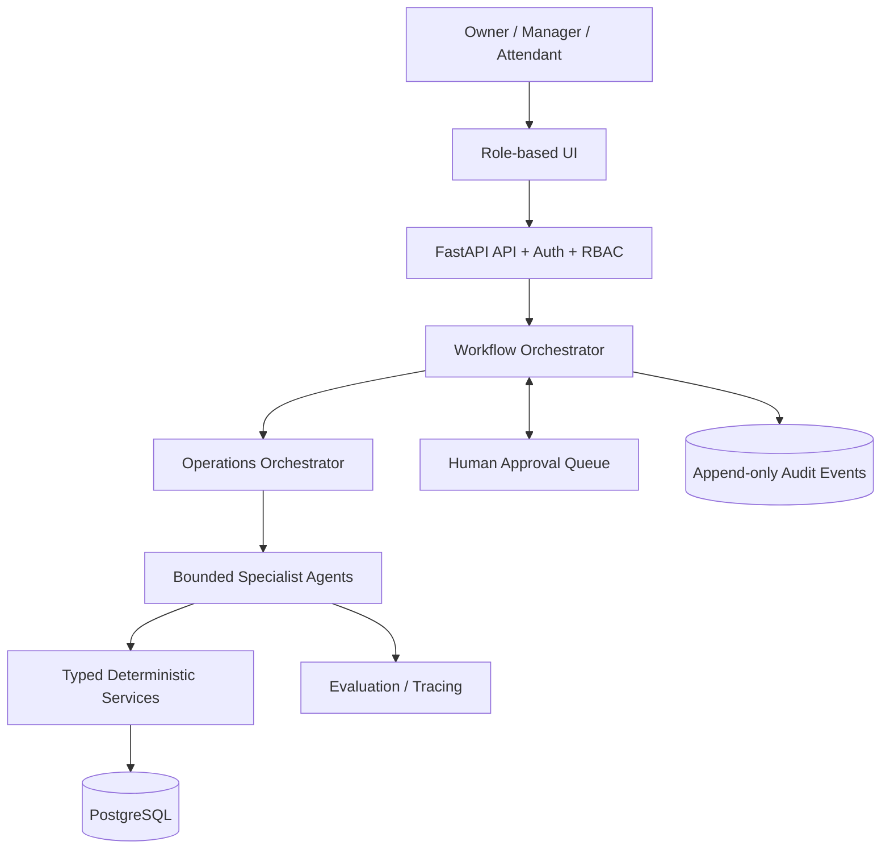

# System Design

## Executive summary
AFSOIS is a proposed operations-intelligence platform for a retail fuel station. It reconciles physical fuel movement with financial movement using validated records, deterministic calculations, bounded agents, advisory analytics and human oversight. It is a portfolio design and early reference prototype, not a deployed or certified control system.

## Goals
- Capture meter readings, dip readings, deliveries, sales, cash/credit allocations and shift handovers.
- Reconcile expected versus measured wetstock and sales versus payment allocations.
- Build evidence-backed incidents and delivery disputes.
- Apply versioned procurement and credit policies.
- Demonstrate responsible agent orchestration using synthetic data.

## Non-goals
No live dispenser/PLC/tank-probe/CCTV/fire-system/emergency-shutdown control; no bank transfers, vendor payments, refunds, autonomous credit issuance or ledger edits; no regulatory certification; no production POS, bank or supplier integrations.

## Hybrid architecture

## Source-of-truth hierarchy
1. Validated records and evidence with provenance.
2. Deterministic domain calculations.
3. Versioned policy/configuration.
4. Agent interpretation linked to tool outputs.
5. Human-approved correction/disposition.

## Key formulas
- `meter_sales = closing_meter - opening_meter`
- `expected_closing = opening + receipts - sales + approved_adjustments`
- `residual = measured_closing - expected_closing`
- `delivery_variance = measured_tank_increase - supplier_claimed_litres`
- `sales_value = validated_litres × effective_unit_price`

Positive residual means measured stock exceeds expected stock. A lower meter closing value must trigger reset/rollover review, not an assumed negative sale. Dip conversion requires a tank-specific versioned chart; no extrapolation. No universal allowable-loss percentage is hardcoded.

## Numeric and event integrity
Use Decimal for measured volumes and currency. Store units and currency explicitly. Each event has an event ID and idempotency key. Corrections append reversal/correction events; never overwrite verified history. Evidence files have content hashes and access controls.

## Roles
| Role | Access |
|---|---|
| Owner | All records, policy proposals, high-impact approvals |
| Manager | Operational records, shift/delivery/exception review, delegated approvals |
| Attendant | Assigned readings, handovers and checklists |
| Accountant | Financial review and delegated finance approvals only |
| Technician | Equipment/maintenance records |
| Auditor | Time-bounded read-only access |

Enforce permissions in API/data-access layers, not prompts.

## Deployment approach
Start as a modular application, PostgreSQL, background worker and isolated agent runtime. Docker Compose is sufficient for a portfolio prototype. Defer Kubernetes until justified.
