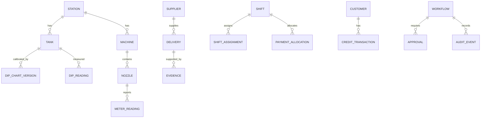

# Conceptual Data Model

Core entities: stations, users/roles, tanks, dip-chart versions/points, dip readings, machines/nozzles, meter readings, shifts/assignments/handovers, sales/payment allocations, customers/credit transactions, suppliers/purchase requests/orders/deliveries, evidence, cash counts/deposits/reconciliations, incidents, approvals, agent runs, tool invocations and audit events.

Every station record carries station scope. Measurements carry unit, timestamp, source/recorder and validation state. Dip readings reference chart version. Financial amounts carry currency/decimal precision. Agent outputs reference source IDs and never become source records.
