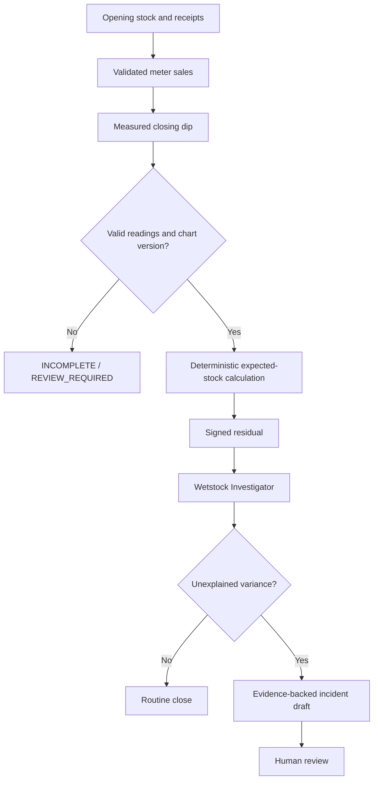

# Wetstock and Delivery

Delivery sequence: create draft; capture pre-dip and chart version; record offload/POD; capture post-dip; calculate tank increase; compare with approved versioned tolerance; mark review/dispute if evidence incomplete or variance exceeds policy; human disposition. No payment release is automated.

A stock discrepancy is a signal, not proof of theft or leakage. Possible hazardous conditions are escalated to qualified staff under the approved site procedure; AI does not control safety equipment.
